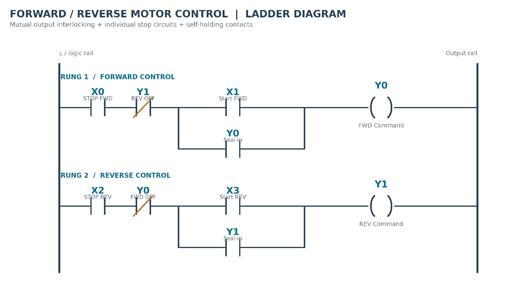
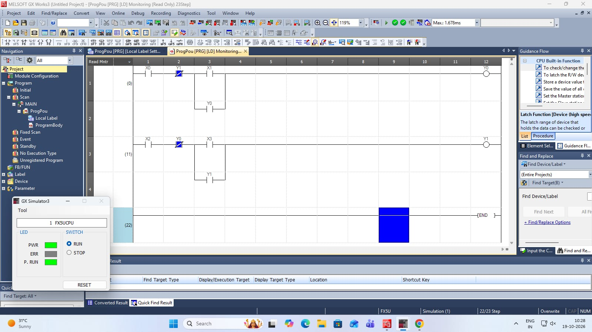

# PLC-Based Forward–Reverse Motor Control System

[](LICENSE)
[](https://www.mitsubishielectric.com/)
[](https://www.mitsubishielectric.com/)
[]()

> **Project Scope Statement:**  
> This project is a basic, beginner-level PLC implementation of forward–reverse motor control using Mitsubishi GX Works3. It demonstrates fundamental PLC concepts such as digital inputs and outputs, self-holding (seal-in) logic, and electrical command interlocking. The project is intentionally simple and is intended for educational purposes rather than as an advanced industrial automation solution.

---

## Table of Contents
1. [Project Overview](#1-project-overview)
2. [Project Level and Scope](#2-project-level-and-scope)
3. [Problem Statement](#3-problem-statement)
4. [Project Objectives](#4-project-objectives)
5. [Software and Tools Used](#5-software-and-tools-used)
6. [PLC Input/Output (I/O) Addressing Table](#6-plc-inputoutput-io-addressing-table)
7. [Working Principle](#7-working-principle)
8. [Forward Operation](#8-forward-operation)
9. [Reverse Operation](#9-reverse-operation)
10. [Ladder Logic Explanation](#10-ladder-logic-explanation)
11. [Self-Holding / Seal-In Logic](#11-self-holding--seal-in-logic)
12. [Mutual Interlocking](#12-mutual-interlocking)
13. [Actual Ladder Diagram](#13-actual-ladder-diagram)
14. [Simulation Screenshot](#14-simulation-screenshot)
15. [Step-by-Step Simulation Procedure](#15-step-by-step-simulation-procedure)
16. [Expected Behavior and Test Cases](#16-expected-behavior-and-test-cases)
17. [Industrial Applications](#17-industrial-applications)
18. [Advantages](#18-advantages)
19. [Limitations](#19-limitations)
20. [Future Scope](#20-future-scope)
21. [Safety Precautions & Engineering Warning](#21-safety-precautions--engineering-warning)
22. [Project Information and Academic Details](#22-project-information-and-academic-details)
23. [Repository Contents](#23-repository-contents)
24. [Conclusion](#24-conclusion)

---

## 1. Project Overview

Directional control of electric motors is a foundational requirement across automated manufacturing lines, conveyor systems, hoists, and robotic manipulators. In conventional electromechanical control systems, reversing an induction motor's rotation requires altering its stator phase sequence using dual electromagnetic contactors. 

This project implements the digital control logic for a bidirectional motor starter using a Programmable Logic Controller (PLC). Using **Mitsubishi MELSOFT GX Works3** and **GX Simulator3**, the system evaluates digital operator pushbuttons and drives forward and reverse command outputs while enforcing strict software-level mutual interlocking, Normally Closed (NC) stop logic, and self-holding seal-in logic.

---

## 2. Project Level and Scope

* **Classification:** Basic / Beginner-Level PLC Educational Project
* **Coursework:** Programmable Logic Controllers (PLC) & SCADA
* **Scope Boundary:** 
  * The current scope is confined to digital logic development, input/output signal mapping, self-holding design, mutual interlocking, and software simulation in GX Simulator3.
  * Physical motor power circuits, three-phase contactor wiring, thermal overload sizing, and hardwired mechanical interlocks were studied theoretically as part of industrial requirements and are documented herein, but were not connected to live high-voltage hardware during this simulation study.

---

## 3. Problem Statement

In industrial motor operation, activating both forward and reverse contactors concurrently causes a catastrophic phase-to-phase dead short across the three-phase AC power supply. Such an electrical fault can destroy contactors, trip upstream branch circuit breakers, cause arc-flash hazards, and impose destructive mechanical shock on the motor shaft and driven load.

Therefore, an automated control circuit must guarantee:
1. Reliable starting in forward or reverse directions upon operator command.
2. Continuous run capability via latching after momentary pushbuttons are released.
3. Fail-safe stopping using dedicated Normally Closed (NC) pushbuttons.
4. Strict, foolproof exclusion (interlocking) preventing the reverse command from energizing while the forward command is active, and vice versa.
5. An enforced stop sequence ensuring an active directional command is fully de-energized before the opposing direction can be initiated.

---

## 4. Project Objectives

* Construct a validated PLC ladder logic program for bidirectional motor control.
* Assign and map discrete PLC digital inputs (`X`) and digital outputs (`Y`).
* Implement Normally Closed (NC) Stop pushbuttons for forward and reverse control.
* Implement auxiliary latching (seal-in contacts) to sustain direction commands after momentary start pushbuttons are released.
* Integrate mutual electrical command interlocking using normally closed (NC) software contacts of opposite outputs.
* Verify program execution, rung continuity, and safety interlocking using Mitsubishi GX Simulator3.
* Provide an open, structured academic repository with complete technical documentation and reproducible ladder rungs.

---

## 5. Software and Tools Used

* **PLC Programming Environment:** Mitsubishi Electric **MELSOFT GX Works3** (v1.090+ or compatible)
* **Simulation Engine:** **GX Simulator3** (Built-in execution engine for MELSEC iQ-F / FX5U)
* **Target Controller Architecture:** Mitsubishi Electric **MELSEC iQ-F Series FX5U CPU**
* **Programming Standard:** IEC 61131-3 Ladder Diagram (LD)
* **Version Control:** Git & GitHub

---

## 6. PLC Input/Output (I/O) Addressing Table

The program utilizes four discrete digital inputs and two discrete digital outputs assigned as follows:

| Address | Signal Tag | Field Device Type | Contact Type | Functional Description | Circuit Role |
|:---:|:---:|:---:|:---:|:---|:---|
| **X0** | `STOP_FWD` | Digital Input | **NC (Normally Closed)** | Forward Stop Pushbutton | Forward Circuit Interrupt / Permissive |
| **X1** | `START_FWD` | Digital Input | **NO (Normally Open)** | Forward Start Pushbutton (Momentary) | Initiates Forward Motor Run Command |
| **X2** | `STOP_REV` | Digital Input | **NC (Normally Closed)** | Reverse Stop Pushbutton | Reverse Circuit Interrupt / Permissive |
| **X3** | `START_REV` | Digital Input | **NO (Normally Open)** | Reverse Start Pushbutton (Momentary) | Initiates Reverse Motor Run Command |
| **Y0** | `FWD_CMD` | Digital Output | Relay / Contactor | Forward Contactor Coil | Energizes Forward Direction Starter |
| **Y1** | `REV_CMD` | Digital Output | Relay / Contactor | Reverse Contactor Coil | Energizes Reverse Direction Starter |

---

## 7. Working Principle

The controller operates on a cyclical scan cycle: **Input Scan &rarr; Program Execution &rarr; Output Update &rarr; Housekeeping**.

1. **At Idle:** Outputs `Y0` and `Y1` are de-energized (`0`). Both mutual interlocking contacts `Y1` (in Rung 1) and `Y0` (in Rung 2) remain closed. Stop pushbuttons `X0` and `X2` are Normally Closed, maintaining circuit continuity.
2. **Forward Command:** When Forward Start (`X1`) is momentarily pressed, logic continuity reaches output coil `Y0`. 
3. **Latching:** `Y0` switches to Logic 1, causing its parallel auxiliary contact `Y0` in Rung 1 to close. When `X1` is released, current path is maintained through `Y0`.
4. **Command Interlock:** Concurrently, the normally closed contact `Y0` in Rung 2 opens, severing all logic paths to coil `Y1`. Pressing Reverse Start (`X3`) has no effect.
5. **Stopping:** Pressing Forward Stop (`X0`) opens the normally closed contact in Rung 1, dropping coil `Y0` to Logic 0 and releasing the latch. The interlocking contact `Y0` in Rung 2 returns to its normally closed state.
6. **Reverse Command:** Once `Y0` is completely de-energized, pressing Reverse Start (`X3`) energizes `Y1`, which seals itself in and locks out `Y0` through normally closed contact `Y1` in Rung 1.

---

## 8. Forward Operation

1. System is in idle state (`Y0 = 0`, `Y1 = 0`).
2. Normally Closed Stop pushbutton `X0` is unpressed and closed.
3. Operator presses the momentary Forward Start pushbutton (`X1 = 1`).
4. Permissive conditions verified:
   * Stop Forward NC contact is closed.
   * Reverse command is inactive (`Y1 = 0`, so NC contact `ANI Y1` is closed).
5. Coil `Y0` energizes (`Y0 = 1`).
6. Forward seal-in contact `Y0` closes in parallel with `X1`.
7. Operator releases `X1` (`X1 = 0`); `Y0` remains energized via the seal-in contact.
8. Interlocking contact `Y0` in the reverse rung opens, prohibiting reverse activation.
9. To terminate forward operation, the operator presses Forward Stop (`X0`), opening the contact and dropping `Y0` to 0.

---

## 9. Reverse Operation

1. System must be idle (`Y0 = 0`, `Y1 = 0`). If forward is running, Forward Stop (`X0`) must be pressed first.
2. Normally Closed Stop pushbutton `X2` is unpressed and closed.
3. Operator presses the momentary Reverse Start pushbutton (`X3 = 1`).
4. Permissive conditions verified:
   * Stop Reverse NC contact is closed.
   * Forward command is inactive (`Y0 = 0`, so NC contact `ANI Y0` is closed).
5. Coil `Y1` energizes (`Y1 = 1`).
6. Reverse seal-in contact `Y1` closes in parallel with `X3`.
7. Operator releases `X3` (`X3 = 0`); `Y1` remains energized via the seal-in contact.
8. Interlocking contact `Y1` in the forward rung opens, prohibiting forward activation.
9. To terminate reverse operation, the operator presses Reverse Stop (`X2`), opening the contact and dropping `Y1` to 0.

---

## 10. Ladder Logic Explanation

The ladder program consists of two primary control rungs terminated by an `END` instruction (23 program steps total in Mitsubishi FX5U):

```
RUNG 1 (Step 0) - Forward Motor Control:
 |--[/ X0 ]--+--[/ Y1 ]--+--[ X1 ]--+--( Y0 )--|
             |           |          |
             |           +--[ Y0 ]--+
             |
RUNG 2 (Step 11) - Reverse Motor Control:
 |--[/ X2 ]--+--[/ Y0 ]--+--[ X3 ]--+--( Y1 )--|
             |           |          |
             |           +--[ Y1 ]--+
             |
STEP 22 - End of Scan:
 |-------------------------------------[ END ]-|
```

### Boolean Equations
* **Forward Command ($Y_0$):**
  $$Y_0 = \overline{X_0} \land \overline{Y_1} \land (X_1 \lor Y_0)$$
* **Reverse Command ($Y_1$):**
  $$Y_1 = \overline{X_2} \land \overline{Y_0} \land (X_3 \lor Y_1)$$

---

## 11. Self-Holding / Seal-In Logic

Because industrial start pushbuttons are spring-loaded momentary devices that return to their resting position upon release, a continuous control command cannot rely on physical contact closure:

* A normally open auxiliary contact assigned to the output coil (`Y0` in Rung 1, `Y1` in Rung 2) is wired electrically in parallel across the start pushbutton contact (`X1` and `X3` respectively).
* When the start button is depressed, current energizes the coil. During the subsequent program scan, the controller reads the output state as `1`, causing the parallel contact to close.
* When the start pushbutton spring forces it back open, the auxiliary contact maintains the conducting branch, "sealing in" the circuit indefinitely until the normally closed stop pushbutton breaks the rung.

---

## 12. Mutual Interlocking

Mutual interlocking is the programmatic exclusion mechanism that guarantees `Y0` and `Y1` can never be active simultaneously:

* In Rung 1 (Forward), a normally closed (NC) contact of Reverse Output `Y1` (`ANI Y1`) is placed in series with the forward rung.
* In Rung 2 (Reverse), a normally closed (NC) contact of Forward Output `Y0` (`ANI Y0`) is placed in series with the reverse rung.
* If `Y0` is ON, its NC contact in Rung 2 is forced OPEN. Even if an operator pushes Reverse Start `X3`, rung continuity is physically interrupted before reaching coil `Y1`.
* Conversely, if `Y1` is ON, its NC contact in Rung 1 is forced OPEN, preventing any forward energization until reverse is formally stopped.

---

## 13. Actual Ladder Diagram

The verified academic ladder diagram for the forward–reverse control system, featuring **Normally Closed (NC) Stop pushbuttons** (`X0` and `X2`), mutual output interlocking, and self-holding seal-in contacts:



*Figure 1: Authentic Ladder Diagram showing NC Stop pushbuttons, mutual interlocking, and self-holding contacts.*

---

## 14. Simulation Screenshot

The program running live inside Mitsubishi MELSOFT GX Works3 and monitored with GX Simulator3:



*Figure 2: Live online monitoring in GX Works3 (ProgPou [PRG] [LD] Monitoring, 23 Step) executing on FX5U CPU simulator in RUN mode.*

---

## 15. Step-by-Step Simulation Procedure

To replicate the simulation in **MELSOFT GX Works3**:

1. **Launch Software:** Open Mitsubishi MELSOFT GX Works3.
2. **Create Target Project:**
   * Series: `MELSEC iQ-F`
   * Type: `FX5U`
   * Program Language: `Ladder Diagram (LD)`
3. **Input Ladder Rungs:**
   * Enter Step 0 (Forward Rung): `LDI X0`, `ANI Y1`, `LD X1`, `OR Y0`, `ANB`, `OUT Y0`.
   * Enter Step 11 (Reverse Rung): `LDI X2`, `ANI Y0`, `LD X3`, `OR Y1`, `ANB`, `OUT Y1`.
   * Enter Step 22: `END`.
4. **Compile Program:** Press `F4` (Convert &rarr; Rebuild All). Confirm 0 Errors, 0 Warnings.
5. **Start Simulation:** Select **Debug** &rarr; **Simulation** &rarr; **Start/Stop Simulation**.
   * The **GX Simulator3** dialog appears showing `FX5UCPU`.
   * Verify LEDs: `PWR` is solid green, `P. RUN` is solid green, and switch is at `RUN`.
6. **Online Monitor Mode:** Press `Shift + F3` (Online &rarr; Monitor &rarr; Start Monitoring).
7. **Stimulate Inputs:**
   * Right-click `X1` &rarr; **Debug** &rarr; **Modify Value** (or highlight `X1` and press `Shift + Enter`) to toggle ON momentarily, then toggle OFF. Observe `Y0` turn ON and latch.
   * Attempt toggling `X3` ON. Confirm `Y1` remains OFF due to `ANI Y0` block.
   * Operate `X0` to release `Y0`.
   * Test reverse operation similarly with `X3` and `X2`.

---

## 16. Expected Behavior and Test Cases

The following test suite outlines the verified and expected functional behaviors of the logic:

| Test ID | Initial State | Operator Action / Stimulus | Expected Output Response | Interlock / Latch Status |
|:---:|:---|:---|:---|:---|
| **T01** | Power-up / System Reset | None (System Idle) | `Y0 = 0`, `Y1 = 0` | All coils de-energized; interlocks conductive |
| **T02** | Idle (`Y0=0, Y1=0`) | Press Forward Start (`X1 = 1`) | `Y0 = 1`, `Y1 = 0` | Forward coil energizes immediately |
| **T03** | Forward Running (`Y0=1`) | Release Forward Start (`X1 = 0`) | `Y0 = 1`, `Y1 = 0` | Output remains energized via `Y0` seal-in |
| **T04** | Forward Running (`Y0=1`) | Press Reverse Start (`X3 = 1`) | `Y0 = 1`, `Y1 = 0` | Reverse command remains **BLOCKED** by `ANI Y0` |
| **T05** | Forward Running (`Y0=1`) | Press Forward Stop (`X0` NC opens) | `Y0 = 0`, `Y1 = 0` | Forward coil de-energizes; latch drops out |
| **T06** | Idle (`Y0=0, Y1=0`) | Press Reverse Start (`X3 = 1`) | `Y0 = 0`, `Y1 = 1` | Reverse coil energizes immediately |
| **T07** | Reverse Running (`Y1=1`) | Release Reverse Start (`X3 = 0`) | `Y0 = 0`, `Y1 = 1` | Output remains energized via `Y1` seal-in |
| **T08** | Reverse Running (`Y1=1`) | Press Forward Start (`X1 = 1`) | `Y0 = 0`, `Y1 = 1` | Forward command remains **BLOCKED** by `ANI Y1` |
| **T09** | Reverse Running (`Y1=1`) | Press Reverse Stop (`X2` NC opens) | `Y0 = 0`, `Y1 = 0` | Reverse coil de-energizes; latch drops out |
| **T10** | Running (Either state) | Stop contact opens | Active output drops to `0` | Fail-safe circuit interruption |

---

## 17. Industrial Applications

Although this capstone project is an educational model, identical bidirectional logic principles are applied across diverse industrial equipment:
* **Overhead Cranes and Hoists:** Up/Down directional lifting mechanisms.
* **Automated Conveyor Belts:** Bidirectional material transfer and sorting lines.
* **Motorized Valves and Dampers:** Open/Close motorized valve actuators in process plants.
* **Rolling Shutters and Industrial Gates:** Forward (Raise) and Reverse (Lower) warehouse doors.
* **Machine Tool Feeds:** Forward feed and reverse return on milling and lathe carriages.

---

## 18. Advantages

* **Eliminates Complex Relay Wiring:** Replaces multi-relay hardwired cabinets with programmable software logic.
* **High Modularity:** Logic changes or parameter adjustments are made in software without rewiring hardware.
* **Online Diagnostic Visibility:** Troubleshooting input sensors and output states is performed in real-time via software monitor mode.
* **Reliable Command Isolation:** Software interlocking ensures zero overlap between directional commands.

---

## 19. Limitations

* **Command-Level Only:** The PLC program controls command signals (`Y0`, `Y1`). It does not inherently detect physical contactor welding or mechanical binding without auxiliary feedback.
* **Instant Reversal Shock (Plug Reversal Risk):** If an operator presses Stop and immediately presses the opposing Start button, the motor receives full reverse voltage while still spinning forward, causing severe mechanical strain and high current inrush. A physical installation requires an off-delay anti-plugging timer.
* **Single-Point CPU Failure:** If the PLC processor faults or outputs latch on due to contactor failure, software interlocking alone cannot disconnect the motor.

---

## 20. Future Scope

For students and engineers looking to expand this basic capstone implementation into an industrial-grade starter:
1. **Transition Timer Delay:** Introduce an off-delay timer (e.g., Mitsubishi `T0` / `T1`) to enforce a mandatory standstill pause (e.g., 3–5 seconds) before allowing the opposite direction to start.
2. **Thermal Overload Feedback:** Wire a physical bimetallic or electronic overload relay auxiliary contact to a dedicated input (e.g., `X4`), breaking both directional rungs upon thermal trip.
3. **Emergency Stop (E-Stop):** Integrate an IEC 60204-1 Category 0 hardwired master safety relay with a dedicated PLC monitoring contact.
4. **HMI Integration:** Develop a touch-screen operator interface using Mitsubishi GOT2000 / GT SoftGOT to display motor status, running hours, and alarm diagnostics.
5. **Physical Hardware Validation:** Wire the PLC outputs to interlocked reversing contactors driving a small 3-phase induction motor.

---

## 21. Safety Precautions & Engineering Warning

> [!CAUTION]
> ### CRITICAL SAFETY WARNING FOR PHYSICAL IMPLEMENTATION
> **Software interlocking inside a PLC ladder diagram does NOT by itself guarantee safe electrical or mechanical motor operation.**
>
> In real-world electrical installations:
> 1. **Hardwired Electrical Interlocking:** The coil circuit of each contactor must be wired in series through the physical normally closed (NC) auxiliary contact of the opposing contactor. If contactor contacts weld shut, hardwired interlocking prevents the opposing coil from pulling in.
> 2. **Mechanical Interlocking:** Reversing contactors must be mechanically linked so that both cannot physically close simultaneously, even if manually forced.
> 3. **Thermal Overload & Short Circuit Protection:** Properly sized motor circuit breakers (MPCB) or thermal overload relays must be installed.
> 4. **Emergency Stop:** E-Stop pushbuttons must cut coil control power via dedicated, fail-safe safety relays independent of PLC software logic.
> 5. **Qualified Personnel Only:** All electrical installation, commissioning, and high-voltage wiring must strictly adhere to national electrical codes (NFPA 79, IEC 60204-1, NEC) and must be performed solely by certified electrical professionals.

---

## 22. Project Information and Academic Details

* **Project Title:** PLC-Based Forward–Reverse Motor Control System
* **Academic Year:** 2026–2027
* **Institution:** St. John College of Engineering & Management (Autonomous Institute, Affiliated to University of Mumbai)
* **Department:** Department of Electronics and Computer Science
* **Course:** Programmable Logic Controllers (PLC) and SCADA
* **Project Guide:** Ms. Hiral Patel (Assistant Professor)
* **Head of Department:** Dr. Md. Immadudin
* **Principal:** Dr. Kamal Shah
* **Student Project Team:**
  * **[Shubham Agre](https://github.com/ShubhamAgre28)** [EU1247019] &mdash; *Repository Maintainer & Project Lead*  
    <a href="https://github.com/ShubhamAgre28"></a>
  * **Himanshu Chouhan** [EU1247043]
  * **Prashant Yadav** [EU1247060]
  * **Roshan Jha** [EU1247018]

---

## 23. Repository Contents

```
PLC-Forward-Reverse-Motor-Control/
├── README.md                           # Comprehensive project documentation
├── LICENSE                             # MIT Open Source License
├── .gitignore                          # Standard git exclusion rules
├── images/
│   ├── ladder-diagram.png              # Verified ladder diagram with NC Stop pushbuttons
│   └── simulation-screenshot.png       # GX Works3 & GX Simulator3 monitor capture
└── plc-program/
    └── README.md                       # Instruction List (IL), device map & recreation guide
```

* **[View PLC Program Details & Recreation Guide](plc-program/README.md)**

---

## 24. Conclusion

The PLC-Based Forward–Reverse Motor Control System successfully demonstrates the fundamental principles of industrial ladder programming using Mitsubishi MELSOFT GX Works3 and GX Simulator3. By incorporating digital inputs, Normally Closed (NC) Stop pushbuttons, self-holding auxiliary latching contacts, and mutual software interlocking, the system provides safe, reliable, and predictable bidirectional control. This project establishes an accessible educational foundation for students and automation enthusiasts studying industrial electrical control.
